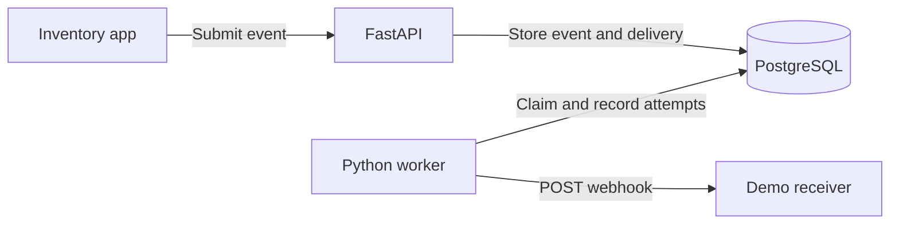
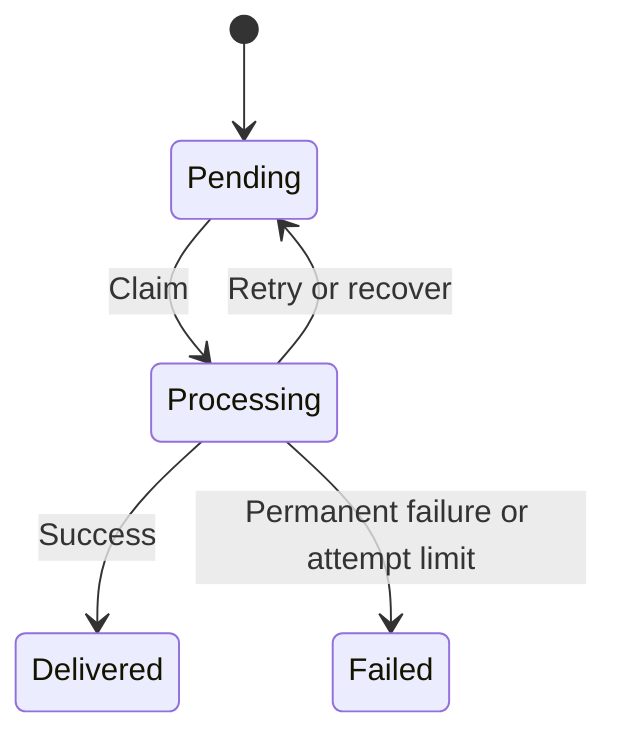

# Webhook Delivery Service

Build a FastAPI service that accepts inventory events and delivers them to one configured webhook receiver. PostgreSQL stores events, pending deliveries, and attempt history. The first release is a local Docker Compose demo built around a `tool.available` event.

## Progress board

Move each card link between columns as you work. Check off subtasks in the card and move it to **Done** when its acceptance criteria pass. Add a note under any blocked card.

| Ready | Backlog | In progress | Blocked | Done |
| --- | --- | --- | --- | --- |
| [01 · Scaffold](#01-scaffold) | | | | |
| | [02 · Local stack](#02-local-stack) | | | |
| | [03 · Database and migrations](#03-database-and-migrations) | | | |
| | [04 · Event submission](#04-event-submission) | | | |
| | [05 · Delivery status](#05-delivery-status) | | | |
| | [06 · Worker and demo receiver](#06-worker-and-demo-receiver) | | | |
| | [07 · Retry policy](#07-retry-policy) | | | |
| | [08 · Restart recovery](#08-restart-recovery) | | | |
| | [09 · Tests and CI](#09-tests-and-ci) | | | |
| | [10 · Demo and portfolio release](#10-demo-and-portfolio-release) | | | |

## Architecture

## Development cards

### 01 Scaffold

**Start here**

- [ ] Initialize Python 3.12 and pyproject.toml. Add fastapi, uvicorn, pydantic-settings, sqlalchemy, psycopg[binary], alembic, and httpx. Add pytest, pytest-cov, and ruff for development.
- [ ] Create API and worker entry points and typed settings. Add .env.example for database URL, destination URL, timeout, poll interval, lease duration, retry schedule, attempt limit, and log level.
- [ ] Implement GET /healthz.

**Done when** the API starts and the health endpoint returns 200.

### 02 Local stack

**Depends on 01**

- [ ] Create a Dockerfile and Compose services for API, worker, PostgreSQL, and the demo receiver. Use placeholder commands until the worker and receiver are implemented.
- [ ] Bind the demo API to localhost and use a named PostgreSQL volume.
- [ ] Add make build, make run, make logs, and make stop.

**Done when** the stack starts with Make and the database volume survives a restart.

### 03 Database and migrations

**Depends on 02**

- [ ] Create events with UUID, unique idempotency key, event type, JSONB payload, and creation time.
- [ ] Create deliveries with UUID, unique event foreign key, destination URL, status, attempt count, next attempt time, lease expiry, and delivered time.
- [ ] Create delivery_attempts with UUID, delivery foreign key, attempt number, start and finish times, outcome, HTTP status, and error summary. Enforce uniqueness on delivery and attempt number.
- [ ] Index pending deliveries by next attempt time and processing deliveries by lease expiry. Store timestamps in UTC.
- [ ] Add an Alembic migration. Configure Compose to wait for PostgreSQL readiness and successful migrations before starting the API and worker.

**Done when** a fresh PostgreSQL instance accepts the migration and enforces the expected uniqueness constraints.

### 04 Event submission

**Depends on 03**

- [ ] Implement POST /events with a required Idempotency-Key header and a JSON body containing type and data.
- [ ] Insert the event and pending delivery in one transaction. Persist the configured destination URL on the delivery.
- [ ] Return 202 after commit with event_id, delivery_id, and status_url.
- [ ] Handle duplicate submissions through the unique key. Return the original IDs for the same validated request and 409 for a changed request.

**Done when** two concurrent identical submissions produce one event and delivery. Reusing the key with a different payload returns 409.

### 05 Delivery status

**Depends on 04**

- [ ] Implement GET /deliveries/{delivery_id} with status, attempt count, next retry time, delivered timestamp, and ordered attempt history.
- [ ] Return 404 for unknown IDs. Include outcome and HTTP status when available on each attempt.

**Done when** the caller can follow status_url and inspect the delivery and attempt history.

### 06 Worker and demo receiver

**Depends on 04**

- [ ] Claim eligible deliveries in a short transaction using FOR UPDATE SKIP LOCKED. Increment the attempt number, create an attempt record, and set a lease.
- [ ] Send the webhook outside the transaction using HTTPX with explicit timeouts and redirects disabled.
- [ ] Send event ID, type, timestamp, and data. Reuse X-Webhook-Delivery-Id across attempts.
- [ ] Record a successful 2xx result in a new transaction. Match processing state and attempt number before finalizing.
- [ ] Build a receiver that can return 200 immediately or return 503 once per delivery ID before returning 200.

**Done when** an event reaches the receiver and shows as delivered with one successful attempt in the immediate-success scenario.

### 07 Retry policy

**Depends on 06**

- [ ] Retry timeouts, network errors, 408, 429, and 5xx. Mark redirects and other 4xx responses failed.
- [ ] Default to four total attempts with 5, 15, and 45 second delays. Persist the next attempt time and stop at the attempt limit.
- [ ] Log delivery ID, attempt number, status, and duration. Omit credentials and payloads.

**Done when** a 503 followed by 200 succeeds in two attempts. A 400 fails immediately. Persistent 503 responses stop at the limit.

### 08 Restart recovery

**Depends on 07**

- [ ] Recover expired claims and record interrupted attempts as unknown. Requeue if attempts remain, otherwise mark failed.
- [ ] Guard completion and attempt history updates so stale workers cannot overwrite a newer attempt.
- [ ] Explain why a receiver might get the same webhook twice and how to deduplicate using the delivery ID.

**Done when** restarting a worker allows an expired claim to be recovered. A stale update leaves newer results intact.

### 09 Tests and CI

**Depends on 05, 07, 08**

- [ ] Use pytest and HTTPX mock transport for response classification and retry tests.
- [ ] Use real PostgreSQL for migration, concurrent submission, competing claim, lease recovery, and stale completion tests.
- [ ] Add make test and make lint. Configure GitHub Actions to apply migrations and run checks on pushes and pull requests.

**Done when** lint and tests pass locally and in CI.

### 10 Demo and portfolio release

**Depends on 09**

- [ ] Write a README with architecture, Make commands, API examples, and design tradeoffs.
- [ ] Run the demo from a fresh checkout. Submit tool.available and show the 503 → 200 retry in the status API.
- [ ] Resubmit with the same key and payload and verify the original IDs. Restart the stack and check that persisted delivery history is available.
- [ ] Publish the finished project and tag v1.0.0.

**Done when** a reviewer can start the stack and reproduce the retry and duplicate-submission demos from the README.

